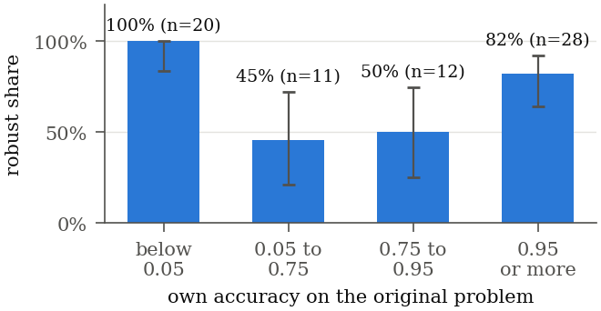

# Predicting Reasoning Robustness from Hidden-State Stability

**Yupeng Tang**, Georgia Institute of Technology
Codabench participant `ytang`. Nominated entries: representation stability, all 31 features (Main, 991098) and its hidden-state-only variant (Small, 1022932).
Code: https://github.com/yupengtang/aimo-interp-challenge-2026

## 1. Summary

The nominated method never generates text. For each problem it shows the evaluated model the original statement and six rewrites that cannot change the answer, runs one forward pass per view, and measures how far the model's own hidden state and next-token distribution move. A logistic regression over those movements, calibrated separately for each checkpoint, gives the verdict. Every number it uses comes from the model being judged. On the Small track we nominate the same pipeline restricted to the hidden-state measurements.

Under the per-problem evaluation the organizers introduced on 15 October, the full method scores 13/21 on the Main track and the hidden-state variant scores 10/14 on the Small track. A strict ablation separates the two signals. On Small the hidden states alone lift the method from its constant fallback, 7/14, to 10/14. On Main they score 10/21, below the fallback's 11/21, and the signal comes from the output distribution instead (Section 4).

| Method | Main (21 cases) | Small (14 cases) | Signal |
|--------------------------------------------|--------------|--------------|-----------------------------|
| Representation stability, 31 features (Main entry) | 13/21 = 0.62 | 9/14 = 0.64 | hidden states, output distribution |
| Hidden-state features only (Small entry) | 10/21 = 0.48 | 10/14 = 0.71 | evaluated model's hidden states |
| Problem-level judge (black-box comparison) | 13/21 = 0.62 | 8/14 = 0.57 | gpt-oss-120b's answers |
| Judge read from gpt-oss hidden states (Section 7) | 11/21 = 0.52 | 7/14 = 0.50 | gpt-oss-120b's hidden states |

The comparison method, a judge that asks gpt-oss-120b how settled it is on the problem, reaches 0.84 accuracy on the official training labels and falls to 0.62 on validation. The organizers later explained why: validation was built so that every problem has both robust and non-robust configurations, and the test set follows the same construction. A verdict that depends only on the problem is then close to chance by design. The stability signal is computed per model, from that model's own internals, so it can disagree across configurations of the same problem. That is the property the evaluation rewards, and the main reason we nominate it.

Section 5 adds what we found about which configuration of a problem breaks: in the labelled data the configuration's own accuracy on the original problem separates the two in a U shape (Figure 1). We could not measure it well enough within the time limit to use it.

Beyond the leaderboard, we think three things here are useful to others. The detector is cheap: seven forward passes of the evaluated model, no generated text, 5 to 16 seconds per case. We show, with the organizers' construction and our own measurements, why any verdict that depends only on the problem stalls on per-problem-balanced data, however well it ranks problems. And we document the approaches that failed, including a sign flip between MATH and competition problems in what "robust" correlates with, so that others do not repeat them.

## 2. The setting

`are_robust(model_id, problems, reasoning_effort)` runs offline on one GPU. Since 15 October the harness calls it once per case with a one-problem list, under a limit of 70 minutes for the run. A case is robust when no perturbation lowers the model's accuracy by more than 0.10, and not robust when some perturbation lowers it by 0.25 or more; cases in between are left out.

Two properties of the data shape everything below. In training, labels follow the problem: `aimo-interp/train-main-v2` has 71 labelled rows over 36 problem statements, fifteen problems are labelled for two or more configurations, and fourteen of those have the same label for every configuration, so predicting a row from its siblings is right 50 times in 51. Validation and test are built the other way. Every validation problem has at least one robust and at least one non-robust configuration (organizers, by email, October 2026), and the public validation sets are balanced overall as well: always-robust scores 10/21 and 7/14, never-robust 11/21 and 7/14.

## 3. The nominated method

**Views.** Each problem gets six rewrites in three families: two transpose letters inside long prose words, two insert a neutral sentence that carries no quantity, and two add a neutral wrapper before or after the statement. LaTeX spans and Asymptote blocks are never edited. Rewrites are seeded by problem id, so they are identical across runs.

**White-box features.** One forward pass per view over the chat-formatted prompt of the evaluated checkpoint. Between the original and each rewrite we take the cosine similarity of the last prompt token's hidden state at four depths, and the KL divergence of the next-token distribution. These are aggregated as mean and minimum within each family, plus the prompt length, giving 31 features. Depths are named by quartile of the layer stack, so one coefficient vector fits checkpoints with different layer counts. Every feature compares a model with itself, so the features are dimensionless and comparable across checkpoints in a way raw hidden states are not.

**Training.** L2-regularised logistic regression with C = 0.003 on 154 DeepSeek-R1-0528-Qwen3-8B cases from the public MATH labels (38 robust), with the olympiad problems held out. C was chosen by cross-validation grouped by problem text over five seeds; in-domain grouped CV AUC is 0.693. The Small-track entry keeps only the 24 hidden-state features; the same search picks C = 0.3 for it (CV AUC 0.694).

**Calibration.** For each checkpoint, features are standardised with statistics from 226 problems whose labels we did not use: 216 public olympiad problems from AIME and AMC collections, and 10 MATH problems whose only labels belong to a non-competition model. The threshold is the median score on that pool, so the detector calls about half the cases robust, which matches the balanced construction of validation and test.

**Runtime.** Views run one at a time, on purpose: a padded batch moves hidden states enough to flip one verdict in six for two checkpoints, and the artifact was fitted on unpadded features. On the competition worker under per-problem calls every case finished in 5 to 16 seconds (21 cases in 189 s on Main, 14 in 81 s on Small), with no timeouts and no case answered by the fallback. If time ever ran short, rewrite families are dropped in order, and any failure returns the constant fallback, so a case cannot become invalid.

## 4. Ablation: the white-box component

The full method mixes 24 hidden-state cosines with six divergences of the next-token distribution, an output-level signal the organizers do not count as white-box, and prompt length. We refit the classifier on each part with the same training cases, search over C and per-checkpoint calibration, and scored each variant on both validation sets. With no features the method returns its constant fallback.

| Features used | Main (21 cases) | Small (14 cases) |
|------------------------------------------|----------------|----------------|
| All 31 (Main entry) | 13/21 = 0.62 | 9/14 = 0.64 |
| 24 hidden-state cosines (Small entry) | 10/21 = 0.48 | 10/14 = 0.71 |
| 6 next-token divergences, prompt length | 14/21 = 0.67 | 10/14 = 0.71 |
| None (constant fallback) | 11/21 = 0.52 | 7/14 = 0.50 |

On Small the hidden states carry the method by themselves. Removing them from the Small entry leaves the constant, a loss of three cases or 21 points; in its run log every case took about six seconds, the time its forward passes need. On Main they do not. Hidden states alone score one case below the constant, while the output-level features alone score one case above the full method, so we make no white-box claim for the Main entry. Main also evaluates gpt-oss-120b, a mixture-of-experts model far larger than the four checkpoints of Small, and a cosine feature calibrated across all five may not carry over to it; 21 cases cannot test that, and one case is within run-to-run noise (Section 9).

The weights of the full model warn against reading importance from coefficients. Of its total absolute weight, 79% sits on hidden-state cosines, 16% on the output divergences and 5% on prompt length. Yet on Main the divergences and prompt length, 21% of the weight, do all the work. The features are correlated and the regularisation is strong, so the coefficients describe the fit, and only the ablation says what each part contributes.

On the 34 labelled rows of the four small checkpoints in `train-main-v2` the full method scores accuracy 0.44 and AUC 0.42 [0.18, 0.66]. Train labels follow the problem (Section 2), so a per-model signal has little to gain there; both samples are small.

## 5. What separates configurations within a problem

Robustness is a small maximum drop in accuracy under perturbation. A configuration that never solves the original problem has nothing to lose, so it is robust by construction. One that always solves it is robust unless a perturbation breaks it. One that solves it only part of the time can lose accuracy from sampling alone, because the drop is a maximum over several noisy estimates. That predicts a U shape in the configuration's own accuracy, and the labelled data shows one.

Figure 1 shows this on the public sample (`aimo-interp-challenge-sample-full`: 10 problems, 8 configurations, the competition labelling rule, expert-written perturbation types excluded, 71 cases).

Figure 1. Share of robust cases by the configuration's own accuracy on the original problem, on the 71 cases of the public sample (Wilson 95% intervals). A configuration that never solves the problem is always robust, one that solves it only some of the time is robust about half the time, and one that almost always solves it is robust in most cases.

"Robust if own accuracy is below 0.05 or at least 0.95" reaches 0.78 accuracy and 0.75 balanced accuracy there. With the expert "no solution" perturbation included the top group drops to 36% robust: a configuration that always answers loses accuracy when it keeps answering a problem that has no answer.

The same pattern appears on `train-main-v2`. With the majority answer of all gpt-oss samples as reference, configurations matching it in at least 95% of their samples are robust in 21 of 22 rows; those between 50 and 95% in half the rows. The small checkpoints almost never finish within the 8192 tokens we could afford, so their near-zero accuracy mostly reflects truncation.

We tried two black-box ways of using this, and both did worse than the judge. Inverting the judge for gpt-oss configurations scored 11/21 on Main, against 13/21. Sampling each gpt-oss configuration at its own effort (8 samples, 4096 or 6144 tokens, robust if at least 7 match the reference) scored 0.75 accuracy on train against 0.83 for the judge, because unfinished high-effort samples counted as mismatches.

This is the strongest argument we have for a white-box route: the quantity that separates configurations is a property of the evaluated model on that problem, and reading it from a few forward passes is far cheaper than estimating it by sampling.

## 6. The black-box comparison: a problem-level judge

For every problem not seen before in the run, gpt-oss-120b gets the organizers' solve prompt at low reasoning effort and is sampled sixteen times (temperature 0.6, top-p 0.95, at most 2560 new tokens). The problem is called robust if at least 13 samples give the same answer. The verdict is reused for every configuration asked about that problem.

On the 71 labelled training rows the share of the modal answer has AUC 0.90 [0.78, 0.97], and the rule resamples to 0.84 accuracy and 0.85 balanced accuracy. On validation it scored 13/21 and 9/14 under the old protocol and 13/21 and 8/14 under per-problem calls. When the judge is settled on a problem, the case is robust in 43 of 45 train rows but in 6 of 10 validation cases on each track. With two configurations of a problem carrying opposite labels, any one-verdict-per-problem rule is right on exactly one of them; with more configurations it can only match each problem's majority. Train, where labels follow the problem, cannot show this ceiling.

Our first estimate of the judge was too optimistic. A first run with four samples per problem made "all four agree" score 0.87 balanced accuracy. A second independent draw scored 0.76, and resampling put the rule at 0.68 with a standard deviation of 0.07. The first draw was about two and a half standard deviations lucky, and we had chosen the threshold on it. Every judge estimate above is therefore a resampled mean.

## 7. The judge, read from hidden states

The judge works, but it costs about 50 s of sampling per problem, and it is black-box. We asked whether gpt-oss already knows how settled it will be before it writes anything. For 720 unlabelled olympiad problems from Omni-MATH (stratified by its difficulty rating, every problem that also appears in `train-main-v2` removed) we ran the judge exactly as in the bundle (8 samples, low effort, 3072 tokens) and recorded the share of the modal answer. We also kept gpt-oss's hidden states for the same chat prompt, without generating: the last prompt token and the mean over the prompt, at layers 9, 18, 27 and 36. A ridge probe per feature predicts the modal share; the verdict averages the eight probes, each standardised by its own cross-validated scores, and the threshold calls half of the pool robust. All of these choices were fixed before looking at the official labels.

| Signal | Cost per problem | AUC on the 71 labelled training rows |
|---|---|---|
| Judge, modal-answer share (8 samples) | ~50 s of generation | 0.76 |
| Probe on gpt-oss hidden states (8-probe average) | one forward pass, ~0.2 s | 0.70 |
| Representation stability (Section 3) | 7 forward passes of the evaluated model | 0.42 |
| Text only: fewer `$` signs | none | 0.71 |
| Text only: shorter statement | none | 0.65 |

On the training rows the probe is close to the judge and far above the stability method, but it is not separable from a count of `$` signs: 36 problems cannot tell them apart. The pool can. Across 720 problems the cross-validated probe correlates 0.66 with the judge's modal share, while statement length and `$` count correlate 0.32 and 0.27. Most of what the probe reads is therefore not surface form. Run as the competition harness runs it, the bundle loads gpt-oss once (565 s cold on our cluster) and then answers 36 problems in about 7 s, with no case on the fallback.

The probe inherits the judge's limitation: it gives one verdict per problem, so on per-problem-balanced data it can only match each problem's majority (Section 6). On validation it scored 11/21 on Main and 7/14 on Small, exactly the never-robust baseline (scored on the organizers' temporary queue during the Codabench outage). That is the ceiling of Section 6 made concrete: a signal read from the problem alone, however well it ranks problems, cannot separate the configurations that validation was built to separate. We report it as a cheap white-box copy of the judge; it is not one of our nominated submissions.

## 8. What did not work

| Approach | Evidence | Why |
|---|---|---|
| Last-token hidden-state probe trained on MATH | MATH AUC 0.74; 0.41 to 0.65 on olympiad problems | In-domain CV ranks encoders almost opposite to transfer |
| Answer agreement under cheap rewrites, same model | AUC 0.385 at 8192 tokens | No signal once truncation is handled |
| Label-free domain standardisation | Moves AUC by at most 0.03 | Fixes calibration, not ranking |
| Training only on longer MATH problems | CV falls from 0.693 to 0.56 | The signal lived in the short problems |
| Self-labels from answer-format perturbations | Agreement 0.31, majority baseline 0.76 | These perturbations barely break the model |
| Per-checkpoint priors | Probes within one case of the baseline | Section 2 |
| The evaluated model's own uncertainty over a greedy 2048-token trace | Best AUC 0.71 [0.56, 0.85]; no gain added to the judge | No small checkpoint finishes in 2048 tokens |
| Judge's reaction to contradictions it writes itself | AUC 0.74 to 0.79 alone on train; no gain on train or validation | Redundant once agreement is measured well |

On MATH, "robust" mostly means "hard": longer problems, longer traces and failing to finish all predict a robust label there. The robust rate by prompt-length tertile is 0.05, 0.35 and 0.33, and prompt length alone reaches grouped CV AUC 0.713. On `train-main-v2` it is the easy problems that are robust. Anything fitted on MATH should be checked for this sign flip. Truncation can also fake consistency: at 4096 tokens 45% of DeepSeek samples had no answer (22% at 8192), and counting them as disagreements measures trace length.

## 9. Limitations

The validation sets have 21 and 14 cases, the white-box result rests on three Small cases, and the same bundle once scored 13/21 and then 12/21, a nondeterminism we did not trace.

## Acknowledgements

This research was supported in part through research cyberinfrastructure resources and services provided by the Partnership for an Advanced Computing Environment (PACE) at the Georgia Institute of Technology, Atlanta, Georgia, USA.

## AI Use Statement

I used Claude Code (Anthropic) as an assistant for ideation, coding, experiment analysis and drafting the text. I did not use generative AI tools to set the research direction or to make the final choice of which submissions to nominate and report; I made those decisions myself. I have reviewed all AI-assisted work and take full responsibility for the final content of this report.

## Appendix A. Reproducing the nominated methods

**Environment.** torch 2.12.1 with CUDA 13.2, transformers 5.13.0, scikit-learn 1.8.0 and NumPy, matching the competition image. Inference needs only NumPy and joblib beyond torch and transformers, because the artifact stores plain arrays rather than fitted estimators.

**Labelled training data.** `aimo-interp/augmented-sample-math-agg`, `-agg-filtered` and `-full-filtered`. A case is robust when `n_detrimental_permutations` is zero. After holding out the olympiad problems this gives 154 DeepSeek cases.

**Unlabelled calibration data.** `AI-MO/aimo-validation-aime`, `AI-MO/aimo-validation-amc`, `opencompass/AIME2025` and `Maxwell-Jia/AIME_2024`, deduplicated, with any problem that appears in the official data removed (216 problems), plus 10 problems from `hendrycks-math-test-reference-100` whose labels exist only for Llama-3.1-8B; those labels are not read.

**Steps.** `code/perturb_stability.py` computes the 31 features for every checkpoint. `code/train_stability_model.py --out stability_crossmodel.joblib` fits the classifier and the per-checkpoint calibration. The bundle in `submission_stability/` is `solution.py`, `scoring.py`, `perturbations.py`, `budget.py` and `stability_crossmodel.joblib`; the Small-track zip adds an empty `small.txt`. `code/trainv2_bundle_eval.py` scores it on the official training rows. The Small-track entry is the same bundle with the artifact from `train_stability_model.py --drop-prefix kl_ --drop-prefix prompt_tokens` (24 features, in `submission_stability_hidden/`); `--drop-prefix cos_` gives the output-level variant of Section 4.

**Comparison method and Section 5.** The judge is `submission/solution.py` (a single file). `code/nosol_experiment.py`, `code/judge_rules.py` and `code/trainv2_bundle_test.py` reproduce Section 6; `code/own_acc_rule.py` reproduces Section 5.

**Section 7 (the judge read from hidden states).** The pool is the 720 Omni-MATH problems listed in `data/pool_omni720_ids.txt` (`KbsdJames/Omni-MATH`, test split, by row index). `code/distill/judge_pool.py` writes the judge targets (with `code/distill/judge_v3.py`, the 8-sample judge) and the hidden states for the pool and for the 36 training problems; `code/distill/fit_probe.py` produces the comparison table; `code/distill/export_probe.py <results> 0.5 probe.npz` fits the eight probes and the threshold. The bundle in `submission_whitebox_v2/` is `solution.py` and `probe.npz`; the Small-track zip adds an empty `small.txt`. Job scripts are `jobs/aimo_distill.sbatch`, `jobs/fit_probe.sbatch` and `jobs/aimo_wb2_test.sbatch`.

**Determinism.** Rewrites are seeded by problem id and inference does no sampling, so the stability verdicts depend only on the model's forward passes. For the probe of Section 7, two of the 36 training problems got a different verdict in the bundle run than in the offline features: gpt-oss is a mixture-of-experts model, and tiny numerical differences between GPUs can change the experts a token is routed to.
